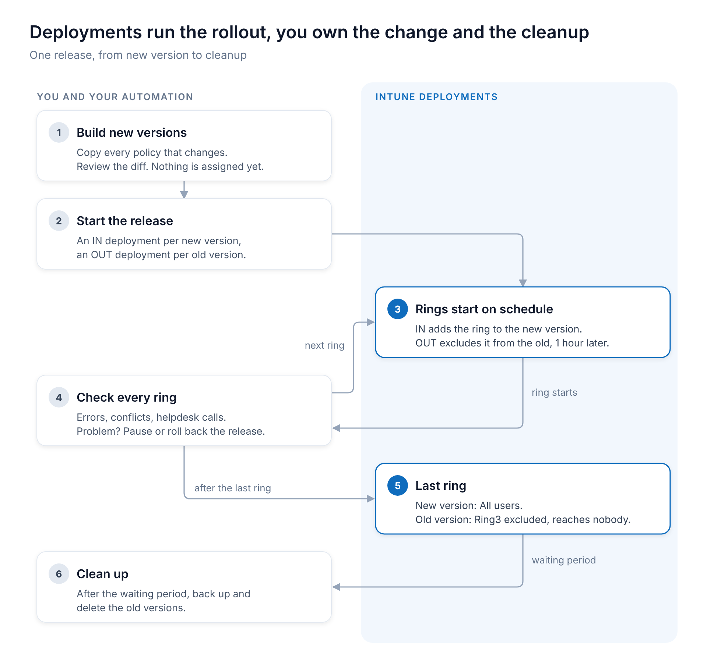

Rolling out a change to an Intune policy in a safe way is more a process question than a tooling question. In this series I explain how I look at that process, how Intune Deployments (now in public preview) take over a big part of it, how what you click in the portal looks in Graph, and how to automate the rest with PowerShell.

In short: a deployment is a timer that adds group assignments to a policy at fixed moments. If you look at it like that, it becomes clear what the feature does for you and what you still have to do yourself. The biggest gap: it puts the new version in, but nothing takes the old version out. Microsoft built the opt-in, not the opt-out. I show two ways to build the opt-out yourself, and which one I would pick for many policies or many tenants.


This post is part of a series about rolling out Intune policy changes with Deployments:

1. **The process, and what Deployments do** (this post)
2. [New version in, old version out]
3. [From the portal to Graph]
4. [Automating the release]

## How I look at the process

Every change to a production policy is a risk. So every change follows the same process, whether it is one setting or a complete baseline. For me, five things are important.

**A change is a release, not an edit.** A real change almost never touches only one policy. A new baseline, a new Windows feature, or a setting that moves from one policy to another changes several policies at once. I put all of them together in one release: new policies, changed policies and removed policies. They go through the rings together, so a device has the old set or the new set, not a mix of both.

**Every change is a new version.** I never edit the policy that runs in production. The change goes into a copy (v002), and the old version (v001) stays until the new one is everywhere. This gives you a diff to review, a history, and a rollback (when its really needed) that is just putting the old version back.

**Rings are about risk, not about departments.** I use a few fixed rings, for example Ring1 for a part of IT, Ring2 for a representative group of users (several roles and departments) and Ring3 for everyone. People can move between rings. The rings themselves don't change per release.

**Time-based, with a check between the rings.** Every release follows the same schedule. Between the rings someone (or something) checks errors, conflicts and helpdesk calls. You have two buttons: stop (nobody else gets it) and roll back (everyone goes back to the old version). From my opinionm the rollback is the last resort. I strongly prefer a rolling forward strategy. When an issue occured, try to fix it. Not to roll back. I know that is utopia, and not always possible. 

**Every release ends in the same state.** When it's done, every policy is assigned to everyone minus the fixed exceptions, and the old versions are gone. If a policy looks different, that is drift.

What you agree on once: the rings and who decides who is in them, a small set of rollout plans, the users or devices that never take part, and who is allowed to stop or roll back.

What happens in every release:

1. Build. Make a new version of the policies that change. Make your changes, and make sure the policy is not assigned yet.
2. Approve. Decide go or no-go, and choose the deployment plan schedule that fits the risk.
3. Start. Plan the release. The plan takes care of the timing.
4. Roll out. Per ring the new versions come in and the old versions go out.
5. Check. Look at every ring. Stop or roll back the whole release if needed.
6. Wait. When everyone has the new versions, keep the old ones for a while as a fallback.
7. Clean up. Delete the old versions and close the release.

## Intune Deployments in a nutshell

With Intune Deployments plan, you can simplify the process a bit. You roll out an app or a policy (Microsoft calls it the payload) in steps, called rings. Every ring starts at a fixed date and time ([Microsoft Intune Deployment overview](https://learn.microsoft.com/en-us/intune/device-management/deployments/overview)). You find it in the Intune portal under **Devices > Manage devices > Deployments**. There are two parts:

| | Deployment plan | Deployment |
| --- | --- | --- |
| What it is | A template that describes how you roll out | One rollout of one payload |
| Contains | Rings with groups and filters, exclude groups, time between rings, platform, scope tags | One payload and a fixed ring schedule, from a plan or set by hand |
| Payload | None | Exactly one. It can't be in another scheduled or active deployment |
| After you create it | You can change it | Only name and description. Payload, rings, schedule, groups and scope tags are fixed |
| Actions | Edit | Pause, resume, cancel |

In the preview it only works for Windows 10 and later. You can use Endpoint Security policies, Settings Catalog policies, Win32 apps and Enterprise App Catalog apps. Both app types only work with the Required intent. To create a deployment you need Read and Assign permissions for the payload's category, so Device configurations for a policy. 
A deployment has no permission of its own, a plan does: Create, Read, Update and Delete under Deployment plan ([permissions and approvals](https://learn.microsoft.com/en-us/intune/device-management/deployments/rbac-scope-tags)).

What happens when a ring starts ([overview](https://learn.microsoft.com/en-us/intune/device-management/deployments/overview), [create a deployment](https://learn.microsoft.com/en-us/intune/device-management/deployments/create-deployment)):

1. Intune adds the groups of that ring as Required include assignments **on the payload itself**, next to the current existing assignments you made by hand.
2. Assignments add up: ring 2 comes on top of ring 1.
3. Exclude groups count for all rings. In the portal you can't give one ring an exclude of its own.
4. A ring with **All users** or **All devices** is always the last ring, and it can't hold other groups. When it starts, it replaces the Required include groups on the payload. Excludes stay.
5. Intune checks for a collision when you create the deployment and again before every ring: the same group on the payload and in a ring. A collision during a ring puts the deployment in an error state and pauses it. You remove the group from the payload and resume.
6. There is at least one hour between two rings.
7. Pause and cancel stop the rings that didn't start yet. Assignments from earlier rings stay on the payload.

So the payload (policy or app) stays the source of truth. If you change its assignments directly, that wins over the deployment.

## A deployment is a timer

When you create a deployment, it makes a copy of the plan. From that moment it is a timer that adds group assignments to the payload at fixed moments. There is no link back to the plan anymore. See it as a timer schedule template.

You can see this in the request the portal sends. It sends the plan ID, but also the full ring schedule with real start times:

```json
POST https://graph.microsoft.com/beta/deviceManagement/deployments

{
  "displayName": "Firewall v002",
  "deploymentPlanId": "79e2fedd-4ceb-49c8-9483-1132c39539a9",
  "payloads": [
    { "payloadId": "56baf26d-8d1b-4905-822c-51f14fc6e227", "payloadEntitySet": "configurationPolicies" }
  ],
  "rings": [
    {
      "displayName": "Ring1",
      "activationCriteria": {
        "@odata.type": "#microsoft.graph.deviceAndAppManagementRingActivationDateTimeCriteria",
        "startDateTime": "2026-10-04T10:00:00.000Z"
      },
      "assignmentConfigurations": [
        { "operation": "Add", "target": { "@odata.type": "#microsoft.graph.groupAssignmentTarget", "groupId": "9ac3fdd9-a852-4a8e-acc9-317301fe9f1b" } }
      ]
    }
  ]
}
```
More about what is going in the backend later in this series. 

So there are two kinds of things:

| Copied into the deployment (fixed) | Linked by ID (live) |
| --- | --- |
| Number of rings and their names | Who is in a group |
| Start times and the time between rings | The rule of an assignment filter |
| Which group is in which ring | |
| Exclude groups | |

Three things follow from this:

- A change to a plan never reaches a deployment that is already running. It only counts for new deployments.
- Group membership always works. Add a device to a ring group and it gets everything that ring already got, also after the deployment is finished.
- After the last ring the deployment doesn't matter anymore. What is left are normal assignments on the policy.

Two side notes. `payloads` is an array, but the documentation is clear: one payload per deployment. Maybe that leaves room for more payloads per deployment later, but today it's one. And the Graph reference for plans uses `topologyDefinitions`, while the admin center reads and sends `rings`. It's a preview API, so first read your own objects with Graph before you build on it.

## How Deployments simplify the process

If you put the process next to the feature, a big part of the rollout moves into Intune. The change itself, the opt-out and the cleanup stay with you.



The steps on the right run on their own schedule. You start them, you watch them, and you clean up afterwards. The diagram shows the first of the two opt-out ways from [part 2](/rolling-out-intune-policy-changes-part-2-new-version-in-old-version-out/), with an OUT deployment. With the second way, a job of yours does the OUT part.

| Step | What Deployments do | What is left for you |
| --- | --- | --- |
| Build new versions | Nothing | Copy, change, review |
| Start the release | One deployment per policy, from a plan | Create them with the same plan and start time |
| Rings on schedule | Start the rings and add the groups | Nothing |
| Old version out | Nothing, a ring only adds | An OUT deployment or a sync job, see part 2 |
| Last ring | All users or All devices replaces the ring groups | Nothing |
| Stop or roll back | Pause, resume, cancel per deployment | Do it for the whole release. On rollback, take the assignments off again |
| Clean up | Nothing | Delete the old versions after the waiting period |
| Overview | Ring status per deployment | Keep the deployments of one release together |

So Deployments run the rollout for you, ring by ring. What they don't do is take the old version away. That gap is the subject of [part 2](/rolling-out-intune-policy-changes-part-2-new-version-in-old-version-out/).

### Sources

- [Deployment plans and deployments overview](https://learn.microsoft.com/en-us/intune/device-management/deployments/overview)
- [Create and manage a deployment](https://learn.microsoft.com/en-us/intune/device-management/deployments/create-deployment)
- [Permissions, scope tags, and approvals for deployments](https://learn.microsoft.com/en-us/intune/device-management/deployments/rbac-scope-tags)
- [Known issues with deployments](https://learn.microsoft.com/en-us/intune/device-management/deployments/known-issues)
- [deviceAndAppManagementDeployment resource (Graph beta)](https://learn.microsoft.com/en-us/graph/api/resources/intune-gntgraphservice-deviceandappmanagementdeployment?view=graph-rest-beta)
- [deviceAndAppManagementDeploymentRing resource (Graph beta)](https://learn.microsoft.com/en-us/graph/api/resources/intune-gntgraphservice-deviceandappmanagementdeploymentring?view=graph-rest-beta)
